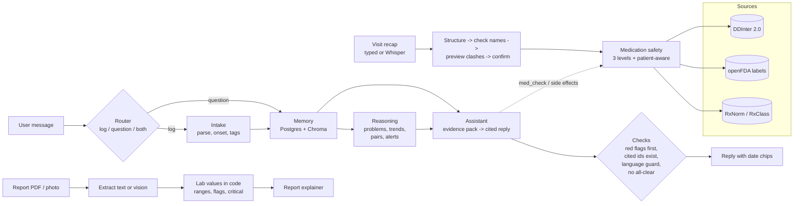

# Personal Health Intelligence Agent

A personal health assistant with **memory**. You tell it how you feel, log readings, upload lab
reports and recap doctor visits; it remembers all of it and answers from your own records, with
dated evidence you can click. It **observes and explains**; it never diagnoses.

> ⚕️ **This is not an AI doctor.** It never diagnoses, never names a cause, never advises treatment,
> and never says two medicines are "safe" together. Everything it says points to the record it came from.

---

## What it does (v2)

- **Assistant with memory.** "Feeling shaky and sweaty, skipped lunch" → it logs it, recalls the three
  earlier episodes with their dates, the circumstances they share (a skipped meal, the morning dose),
  that they all began after a dose increase, and quotes what the doctor said at that visit.
  Red flags (chest pain on exertion, fainting, stroke signs, self-harm, very high BP...) skip the AI and
  show a fixed escalation with 112 / Tele-MANAS 14416.
- **Report explainer.** Upload a PDF, a scan or a phone photo of a lab report. Values are compared with
  the printed range and your previous reports in code; a chat explains it with the glossary and your own
  history, and helps you write questions for your doctor. Critical values show a "contact your doctor today" banner.
- **Doctor visit recaps.** Type or say what happened after a visit. It becomes a note with the doctor's
  words attributed, medicine changes checked against RxNorm (and misheard names flagged), clashes with
  other doctors' medicines previewed, and, once you confirm, your medicines, reminders and questions update.
  A **pre-visit brief** per doctor collects what changed since, printable and shareable.
- **Medication safety, three levels.** **Verified** (DDInter 2.0) → **Official label** (a verbatim
  quote from the FDA label via openFDA, checked by code) → **AI flag** (unverified, switchable). Plus
  patient-aware checks: duplicates across doctors, dose timing ("4 hours apart"), label warnings that match
  your record, side effects that started after a dose change. Nothing found reads exactly: *"No known
  interaction found in our sources. Confirm with your pharmacist."*
- **Longitudinal record.** Problems with frequency trends, symptom pairs, vitals and lab trends, alerts,
  missing-information prompts, a health story, a consultation PDF and a read-only doctor link.

## Ground rules

Observe, never diagnose · code finds the pattern, the AI only words it · every claim cites its evidence ·
the doctor's words are labelled as the doctor's · medicines: the AI can raise a concern, never give the
all-clear · nothing medical is saved without your confirmation · runs locally, and still works if the
primary model provider is down (Groq fallback).

## Architecture



The pipeline is a **LangGraph** graph with fixed edges (the next step is chosen by code, not by an LLM).
Every LLM call goes through `backend/app/core/llm.py`: a LiteLLM proxy first (Claude Haiku for small
jobs, Sonnet for anything a person reads, Sonnet vision for report photos), Groq on any failure
(`openai/gpt-oss-120b`, a Llama 4 vision model, Whisper for audio). Design decisions are logged in
[memory.md](memory.md) (D1–D38); the plan is in [ROADMAP.md](ROADMAP.md).

## Tech stack

**Backend:** Python 3.11 · FastAPI · LangGraph · Pydantic v2 · PostgreSQL (SQLAlchemy 2 + Alembic) ·
ChromaDB (embedded, local `all-MiniLM-L6-v2` embeddings) · OpenAI-compatible clients for LiteLLM and Groq ·
ReportLab · pypdf + pypdfium2 · JWT auth.
**Frontend:** React 19 · Vite · TypeScript · Tailwind CSS · TanStack Query · React Router · Recharts.

## Run it locally

**Prerequisites:** Python 3.11, [`uv`](https://docs.astral.sh/uv/), Node 20+, Postgres 16 (Docker, or the
portable no-admin install below).

```bash
cd backend
cp .env.example .env            # PowerShell: Copy-Item .env.example .env, then fill in the keys
uv run python -m scripts.dev    # Postgres, migrations, demo patients, API :8001 and web :5173
```

Ctrl+C stops both servers. `--reload` restarts the API on code changes.

### Environment (`backend/.env`, see `.env.example`)

| Variable | What it's for |
|---|---|
| `LLM_BASE_URL`, `LLM_API_KEY` | The LiteLLM proxy (primary). List its models: `uv run python -m scripts.llm_smoke_test --list-models` |
| `MODEL_FAST`, `MODEL_SMART`, `MODEL_VISION` | Model names on the proxy (Haiku / Sonnet / Sonnet) |
| `FALLBACK_API_KEY` (or `GROQ_API_KEY`) | Groq: fallback for every task, plus Whisper speech-to-text |
| `FALLBACK_MODEL`, `FALLBACK_VISION_MODEL`, `STT_MODEL` | The Groq models |
| `OPENFDA_API_KEY` | Optional: higher openFDA rate limits |
| `MED_AI_FLAGS_ENABLED` | Level 3 "AI flag (unverified)" interaction findings; off by default |
| `LLM_USAGE_LOG` | One JSON line per call (task, model, tokens, cost); never prompt text |
| `LOCAL_PG_HOME` | Portable Postgres folder on Windows (see below) |

Without any keys the app still runs with deterministic fallbacks (fact lists instead of AI wording).

### Demo patients

| Patient | Login | Shows |
|---|---|---|
| Harsh Iyer, 52 | `harsh@demo.phia` / `demo-harsh-123` | recurring low-sugar pattern, quoting the doctor, the visit loop |
| Priya Nair, 31 | `priya@demo.phia` / `demo-priya-123` | report explainer (phone photo), a clash between two doctors |
| Ramesh Kulkarni, 63 | `ramesh@demo.phia` / `demo-ramesh-123` | a side effect from the official label, red-flag escalation |

All demo data is fictional and dated relative to today. Reset (stop the app first; offline and free after
the first run, from the committed AI cache):

```bash
uv run python -m scripts.demo reset            # all three, or: reset priya
```

Run it once online the day before a demo: the last step caches the FDA labels and drug classes. The
walkthrough is in [DEMO_SCRIPT.md](DEMO_SCRIPT.md).

### Windows without Docker (portable Postgres, no admin rights)

1. Download the PostgreSQL 16 "binaries" zip for Windows x64 from
   https://www.enterprisedb.com/download-postgresql-binaries and unzip it to `%LOCALAPPDATA%\phia-postgres`.
2. Create the data folder once (user and password `phia`):
   ```powershell
   $pg = "$env:LOCALAPPDATA\phia-postgres"
   Set-Content "$pg\pw.tmp" "phia" -NoNewline
   & "$pg\pgsql\bin\initdb.exe" -D "$pg\data" -U phia --pwfile="$pg\pw.tmp" -E UTF8 --locale=C --auth=scram-sha-256
   Remove-Item "$pg\pw.tmp"
   ```
3. In `backend/.env`, set `LOCAL_PG_HOME=C:\Users\<you>\AppData\Local\phia-postgres`.

### Checks and evaluation

```bash
cd backend
uv run ruff check .
uv run pytest                     # offline: every LLM and external API is stubbed; uses a phia_test database
uv run alembic check
uv run python -m scripts.eval_golden   # real models: 33 demo questions, pass rate in tests/eval/results.md
cd ../frontend && npm run build
```

## Data sources and credits

- **DDInter 2.0** (https://ddinter2.scbdd.com/): drug–drug interactions, CC BY-NC-SA 4.0, non-commercial use.
- **openFDA drug labels** (https://open.fda.gov/): official U.S. label text. openFDA notes its data should not
  be used to make medical decisions on its own.
- **RxNorm and RxClass** (U.S. National Library of Medicine): medicine names, ingredients and classes.
- **MedlinePlus** (U.S. National Library of Medicine): links for lab tests and medicines.

## Disclaimer

A B.E. capstone project, for education only. It does **not** provide medical advice, diagnosis or
treatment. Always consult a qualified healthcare professional. (`DEPLOY.md` / `render.yaml` describe the
v1 free-tier deployment and are not maintained for v2, which is a local demo.)
